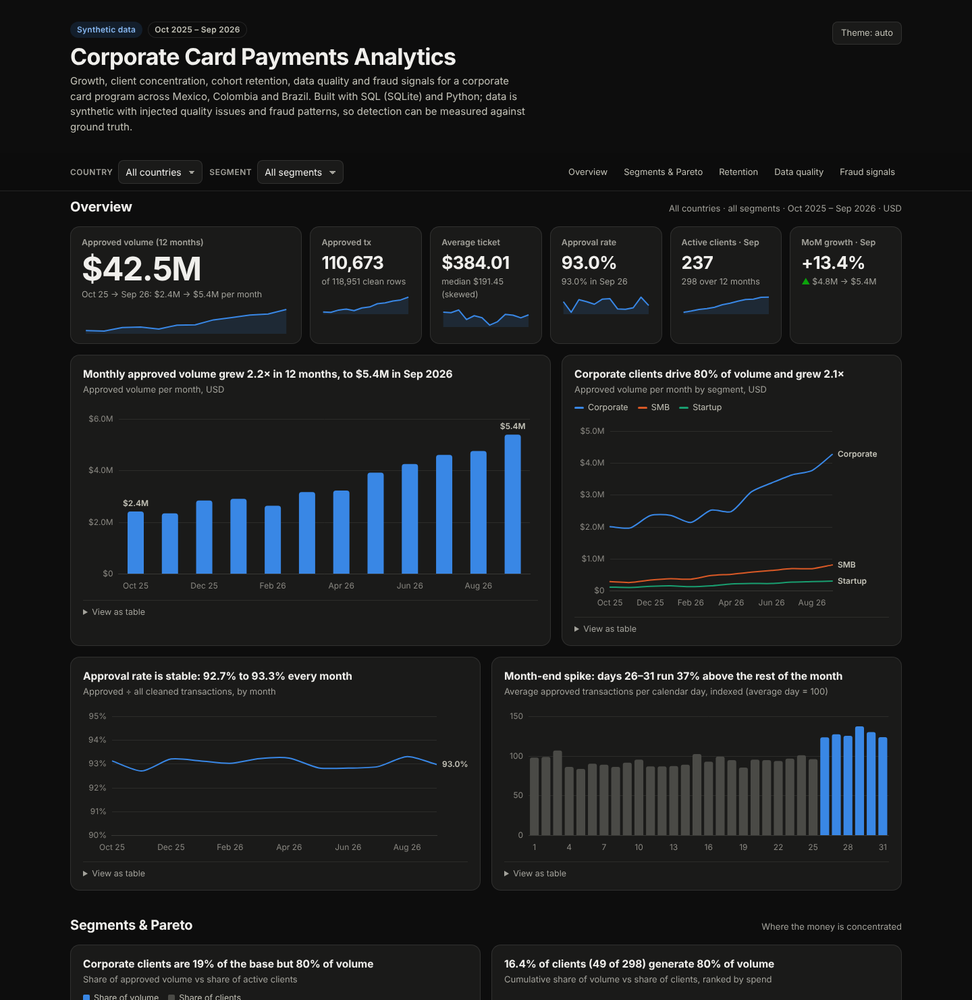
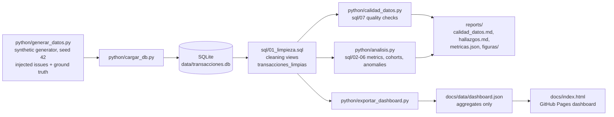

# Corporate Card Payments Analytics

**SQL + Python analysis of 120K corporate card transactions across Mexico, Colombia and Brazil: growth drivers, client concentration, cohort retention, data quality and fraud detection measured against ground truth.**

[](https://www.python.org/)
[](sql/)
[](https://www.sqlite.org/)
[](https://pandas.pydata.org/)
[](https://www.chartjs.org/)
[](LICENSE)

### [Live dashboard →](https://fpadillagarcia100-oss.github.io/analisis-transacciones/)

[](https://fpadillagarcia100-oss.github.io/analisis-transacciones/)

Interactive, filterable by country and segment, dark/light mode, every chart with a table view. Static site served
from [`docs/`](docs/) by GitHub Pages; the data behind it is exported by [`python/exportar_dashboard.py`](python/exportar_dashboard.py).

> **About the data:** the dataset is **synthetic** (no real clients or cards). It comes from a reproducible generator
> with realistic structure (log-normal tickets, month-end seasonality, churn, multi-currency) and **deliberately
> injected** data-quality defects and fraud patterns. Because the generator keeps the ground truth, every cleaning rule
> and fraud detector in this repo is scored with real precision and recall instead of being assumed to work.
> [Details below](#about-the-data).

---

## Business questions answered

| # | Question | Where |
|---|---|---|
| 1 | Which transactions can we trust, and what must be fixed at the source? | [`sql/01_limpieza.sql`](sql/01_limpieza.sql), [`sql/07_calidad_datos.sql`](sql/07_calidad_datos.sql), [`reports/calidad_datos.md`](reports/calidad_datos.md) |
| 2 | How is the business growing month over month, and is it new clients or deeper usage? | [`sql/02_metricas_mensuales.sql`](sql/02_metricas_mensuales.sql) |
| 3 | Where is spend concentrated by segment, country and merchant category? | [`sql/03_segmentos_y_categorias.sql`](sql/03_segmentos_y_categorias.sql) |
| 4 | Does the 80/20 rule hold? How many clients carry 80% of volume? | [`sql/04_top_clientes_pareto.sql`](sql/04_top_clientes_pareto.sql) |
| 5 | Once a client starts spending, how long do they stay? | [`sql/05_cohortes_retencion.sql`](sql/05_cohortes_retencion.sql) |
| 6 | Which cards show spending spikes or card-testing attacks, and how good are the alerts? | [`sql/06_anomalias.sql`](sql/06_anomalias.sql), [`reports/hallazgos.md`](reports/hallazgos.md) |

## Key findings

<!-- FINDINGS:START -->
1. **Volume grew 2.2× in 12 months** (USD 2.4M → 5.4M per month, USD 42.5M approved in total), driven by
   **client acquisition**: active clients grew 2.5× while spend per active client fell 10%, because new clients
   ramp up slowly (their first full month is ~75% of normal spend). Spend per mature client was flat.
2. **Corporate clients are 19% of the base but 80% of volume.** Their average ticket (USD 501) is 3× a Startup's
   (USD 169), and they run more cards per client.
3. **Spend is concentrated: 49 clients (16.4%) generate 80% of approved volume.** That calls for a key-account
   program and a concentration-risk alert.
4. **Retention is strong early and erodes after month 3.** Of clients onboarded in the window, 99.0% are active
   1 month after their first purchase, 95.4% at month 3, 84.5% at month 6 and 81.0% at month 8.
5. **Month-end close drives volume:** days 26-31 run about 37% above the rest of the month (22.9% of transactions
   on 17.8% of calendar days). Authorization capacity and fraud staffing should follow that calendar.
6. **The typical purchase is USD 191, not USD 384.** Tickets are log-normal, so the mean is twice the median.
   Ticket KPIs should report the median and p90.
7. **Data quality:** 1,316 of 120,267 raw rows (1.09%) are unusable: 598 duplicates, 359 missing merchants,
   239 negative amounts that are not reversals, 120 future timestamps. Each rule recovers exactly the injected count.
8. **Fraud signals:** a naive per-card 3σ rule raises 2,226 alerts on 648 cards for 32 real spikes
   (precision 1.3%) because the spikes inflate their own card's standard deviation (masking). A robust
   median/MAD score cuts false alarms 26× (F1 0.33 vs 0.025 per transaction; 21 cards flagged, 7 of 8 compromised). A velocity rule catches
   all 5 card-testing bursts with zero false positives; 16 of their 62 test charges had been approved.
<!-- FINDINGS:END -->

Full write-up with figures, methods and the detector evaluation: **[reports/hallazgos.md](reports/hallazgos.md)**.

## Architecture / pipeline



- **SQL does the heavy lifting.** Cleaning lives in views (`transacciones_limpias`, `transacciones_aprobadas`) that every
  script reuses, so the dashboard, the reports and the ad-hoc queries all agree on one definition of "volume".
- **Python orchestrates and evaluates**: data-quality checks with thresholds, statistical analysis, charts, and
  scoring each detector against the ground truth.
- **The dashboard ships aggregates only** (about 150 KB of JSON, no transaction rows), with every country × segment
  combination precomputed so filtering is instant in the browser.

## Data quality & anomaly detection

**Cleaning.** Four defects were injected into the raw table: duplicate rows with a new id, NULL merchants, negative
amounts that are not reversals (reversals are negative by design) and timestamps after the extraction cut-off.
`sql/01_limpieza.sql` removes them with a `ROW_NUMBER()` dedup plus three filters; `python/calidad_datos.py` runs a
wider battery of checks (domains, orphans, client/card consistency) with explicit thresholds and severities.

**Why the textbook 3σ rule fails here.** Flagging amounts more than three standard deviations above a card's mean
looks reasonable, but in this data it breaks in two ways:

1. *Skew.* Card amounts are log-normal, so "3σ above the mean" happens routinely for legitimate large invoices
   (thousands of alerts).
2. *Masking.* The spikes themselves inflate the mean and the standard deviation used to detect them, so some real
   spikes no longer clear the threshold.

**Robust alternatives.** The median and the MAD (median absolute deviation) barely move when outliers are present.
`sql/06_anomalias.sql` flags cards with at least 3 approved transactions at 25× or more of the card's own median;
`python/analisis.py` adds a modified z-score (median/MAD on category-adjusted log amounts). Both cut false alarms by
more than an order of magnitude.

**Card testing.** Fraudsters validate stolen cards with bursts of micro-charges. A velocity rule, at least 5
transactions under USD 5 on the same card within 10 minutes, implemented as a self-join on `julianday()` windows,
isolates every injected burst. All of them start between midnight and 6 a.m.

Precision, recall and F1 for every detector, plus the precision-recall curve, are in
**[reports/hallazgos.md](reports/hallazgos.md)**.

## SQL highlights

How many clients carry 80% of volume, in one pass with window functions
([`sql/04_top_clientes_pareto.sql`](sql/04_top_clientes_pareto.sql)):

```sql
WITH gasto_cliente AS (
    SELECT cliente_id, SUM(monto_usd) AS gasto_usd
    FROM transacciones_aprobadas
    GROUP BY cliente_id
),
ranking AS (
    SELECT cliente_id, gasto_usd,
           ROW_NUMBER() OVER (ORDER BY gasto_usd DESC) AS posicion,
           COUNT(*) OVER ()                             AS total_clientes,
           SUM(gasto_usd) OVER (ORDER BY gasto_usd DESC
               ROWS BETWEEN UNBOUNDED PRECEDING AND CURRENT ROW) * 1.0
               / SUM(gasto_usd) OVER ()                 AS acum
    FROM gasto_cliente
)
SELECT umbral_pct,
       MIN(posicion)                                    AS clientes_necesarios,
       MAX(total_clientes)                              AS total_clientes,
       ROUND(100.0 * MIN(posicion) / MAX(total_clientes), 1) AS pct_de_clientes
FROM (SELECT 50 AS umbral_pct UNION ALL SELECT 80 UNION ALL SELECT 90) u
JOIN ranking r ON r.acum >= u.umbral_pct / 100.0
GROUP BY umbral_pct
ORDER BY umbral_pct;
```

Elsewhere in [`sql/`](sql/): `LAG()` for month-over-month growth, `SUM() OVER (PARTITION BY ...)` for mix within segment,
recursive CTEs to build the cohort grid, a median computed with `ROW_NUMBER()` (SQLite has no `MEDIAN`), and population
standard deviation from `AVG(x*x) - AVG(x)^2` (SQLite has no `STDEV`). Code and comments in `sql/` and `python/` are
in Spanish; this README, the reports and the dashboard are in English.

## Repository structure

```
analisis-transacciones/
├── data/
│   ├── INJECTED_ISSUES.md        # what was injected, with exact counts
│   └── muestra_transacciones.csv # 500-row sample (full CSVs and the .db are regenerated, not versioned)
├── sql/
│   ├── 01_limpieza.sql           # cleaning views used by everything else
│   ├── 02_metricas_mensuales.sql … 07_calidad_datos.sql
│   └── ejecutar_sql.py           # run any .sql file and print the results
├── python/
│   ├── generar_datos.py          # synthetic generator (seed 42) + ground truth
│   ├── cargar_db.py              # CSV -> SQLite with constraints and indexes
│   ├── calidad_datos.py          # data-quality checks with thresholds
│   ├── analisis.py               # analysis, figures and detector evaluation
│   ├── exportar_dashboard.py     # aggregates -> docs/data/dashboard.json
│   └── run_pipeline.py           # runs everything end to end
├── reports/
│   ├── hallazgos.md              # findings, methods, detector evaluation
│   ├── calidad_datos.md          # data-quality report
│   ├── metricas.json             # every number quoted in the reports
│   └── figuras/                  # PNG charts
├── docs/                         # GitHub Pages site (dashboard)
│   ├── index.html
│   └── data/dashboard.json
├── dashboard/POWER_BI.md         # how to rebuild the dashboard in Power BI
├── tests/
├── run.ps1                       # one-command run on Windows
├── requirements.txt
└── LICENSE
```

## Run it yourself

The full CSVs and the SQLite database are not committed; the pipeline regenerates them (seed 42, so the numbers
match this README).

**Windows (PowerShell)**

```powershell
git clone https://github.com/fpadillagarcia100-oss/analisis-transacciones.git
Set-Location analisis-transacciones
.\run.ps1
```

or step by step:

```powershell
python -m venv .venv
.\.venv\Scripts\Activate.ps1
pip install -r requirements.txt
python python/run_pipeline.py
python -m http.server 8000 -d docs    # open http://localhost:8000
```

**macOS / Linux (bash)**

```bash
git clone https://github.com/fpadillagarcia100-oss/analisis-transacciones.git
cd analisis-transacciones
python3 -m venv .venv && source .venv/bin/activate
pip install -r requirements.txt
python python/run_pipeline.py
python -m http.server 8000 -d docs    # open http://localhost:8000
```

Run a single query: `python sql/ejecutar_sql.py sql/04_top_clientes_pareto.sql`.
Publish the dashboard: see [`docs/README_PAGES.md`](docs/README_PAGES.md) (in Spanish).

## About the data

- **Synthetic, by design.** No real people, companies or card numbers. The generator
  ([`python/generar_datos.py`](python/generar_datos.py)) creates 300 corporate clients (Startup / SMB / Corporate) in
  Mexico, Colombia and Brazil, 900 cards and about 120K transactions from Oct 2025 to Sep 2026 in MXN, COP, BRL and USD.
- **Realistic structure:** log-normal ticket sizes by category and segment, an upward trend with new clients joining
  every month, month-end and weekday seasonality, churn, cancelled and blocked cards, cross-border SaaS and travel
  spend in USD.
- **Injected problems with ground truth:** 4 data-quality defects and 2 fraud patterns (spending spikes on 8 cards,
  card-testing bursts on 5 cards), documented with exact counts in
  [`data/INJECTED_ISSUES.md`](data/INJECTED_ISSUES.md). The row-level ground truth file is regenerated locally and used
  only to score the detectors, never to tune the business analysis.
- **Fixed FX rates** (MXN 18.5, COP 4,100, BRL 5.4 per USD) keep the multi-currency normalization transparent.

The findings describe this simulated portfolio. What transfers to real data is the method: clean in SQL views,
check quality with explicit thresholds, use robust statistics on skewed money data, and measure detectors before
trusting them.

## Author

**Francisco Padilla García** · Actuary & Data Scientist · Guadalajara, Mexico

- GitHub: [@fpadillagarcia100-oss](https://github.com/fpadillagarcia100-oss)
- LinkedIn: <!-- TODO: add LinkedIn profile URL -->

Licensed under the [MIT License](LICENSE).
