# Corporate card payments: key findings

_Synthetic dataset, Oct 2025 to Sep 2026: 120,267 raw
transactions from 3 client segments in Mexico, Colombia and Brazil. Every number below is computed
by `python/analisis.py` on the cleaned view (`sql/01_limpieza.sql`). Spend means approved transactions in USD at fixed
FX rates. Generated 2026-10-15._

## Executive summary

### 1. Volume grew 2.2x in twelve months, and all of it came from new clients

Approved volume went from $2.4M in Oct 2025 to
$5.4M in Sep 2026, a compound 7.6% per month; only
2 of 11 months declined. Active clients grew x2.47 (from
96 to 237), while spend per active client changed -10%.

- **Why:** existing clients are not spending less. Legacy clients (signed up before the window) changed
  x1.04. The average falls because new clients ramp up slowly: in their first full month
  they spend 75% of their steady-state level, because they start with
  1.5 active cards and reach 2.9 only by month 3. In
  Sep 2026, 22% of active clients were still in their first
  three months.
- **Action:** keep funding acquisition, and shorten the ramp: issue all planned cards during onboarding and run a
  90-day activation playbook. Report spend per client separately for ramping and mature clients, so that fast growth
  does not look like declining engagement.

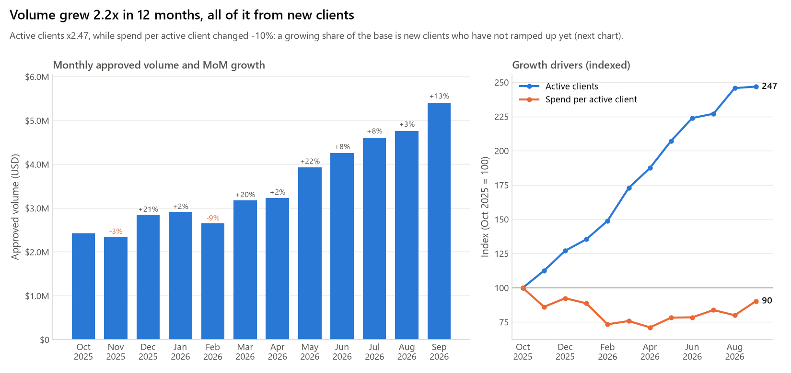

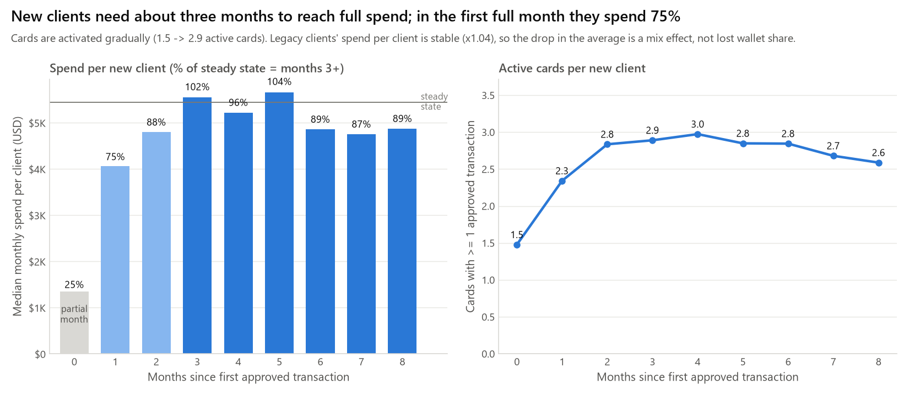

### 2. Corporate clients are 19% of the base but 80% of spend

- **Why:** the drivers multiply. Compared with a Startup, a Corporate client uses
  2.6x as many cards, each card transacts
  3.7x as often, and the mean ticket is
  3.0x larger. Spend per client is therefore
  28x higher ($597K vs
  $21K over the period). Travel is the largest category
  (36% of all spend) and the top category within Corporate spend
  (40%).
- **Action:** prioritise Corporate acquisition and card-issuance campaigns. For Startups and SMEs the cheapest lever
  is cards per client, because spend scales with every extra active card.

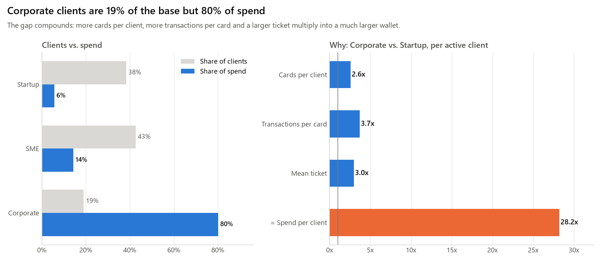

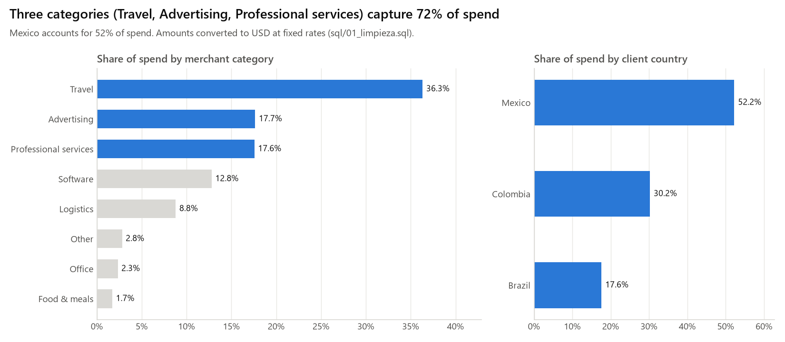

### 3. Spend is concentrated: 49 clients (16%) generate 80% of it

The top 10 clients alone account for 40% of spend (Gini 0.78). The 80% group is
88% Corporate.

- **Why:** the segment economics above, amplified by the wide (log-normal) spread of activity between clients.
- **Action:** run a key-account program (a named owner and a quarterly business review) for the 80% group. Add a
  concentration-risk alert when any single client exceeds a set share of monthly volume.

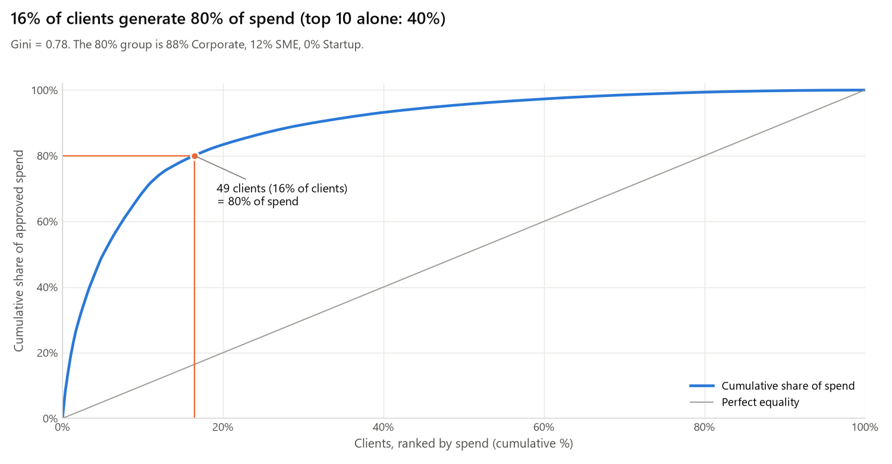

### 4. New clients take a median of 22 days to make their first purchase

Only 38% of the 207 clients who signed up in the window
transacted in their signup month. The median time from signup to first approved transaction is
22 days (75th percentile 42 days).

- **Why:** nothing can be spent before a card exists, and the first card is issued a median of
  19 days after signup.
- **Action:** issue a virtual card at signup and track time to first transaction as an onboarding KPI. This lag is also
  what broke the phase-1 retention metric (see Methods).

### 5. Active clients stay for a quarter, then churn sets in

Retention is the share of a cohort that is active in month k after its first transaction. It is 99.0% at
month 1, 95.4% at month 3 and 84.5% at month 6. The last month with at least
30 observable clients is month 8, at 81.0%.

- **Why:** usage is sticky early, because cards get embedded into expense workflows; the loss concentrates after the
  first quarter (10.9 points lost between months 3 and 6, versus 4.6 in months 0-3).
  Disengagement is also visible among clients who stay: active cards per client slip from
  3.0 at month 4 to 2.6 at month
  8.
- **Action:** build a health score on month-over-month changes in spend and active cards, and have customer success
  reach out between months 3 and 6, before clients go silent.

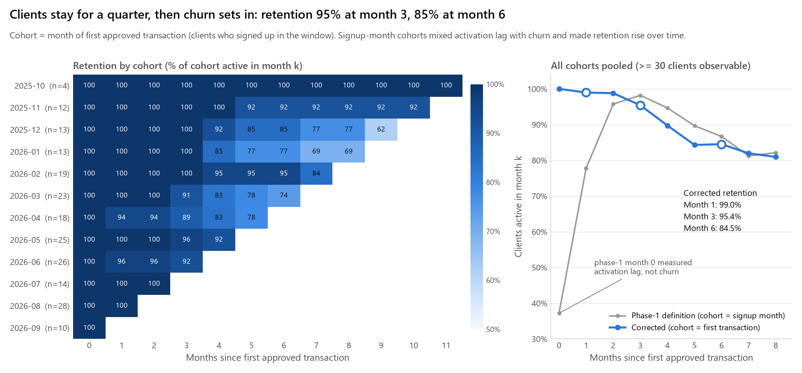

### 6. Month-end closing drives spend: days 26-31 run 37% above a normal weekday

Days 26-31 hold 22.9% of approved transactions but are only
17.8% of calendar days. Days 1-3 run +7% and the 15th
runs +12%. Weekends carry 55% of a weekday's transactions.

- **Why:** companies settle vendors, subscriptions and expense reports around the monthly close.
- **Action:** plan authorisation capacity, fraud-review staffing and credit-limit headroom for the last week of the
  month. Compare month-end metrics with other month-ends, not with mid-month.

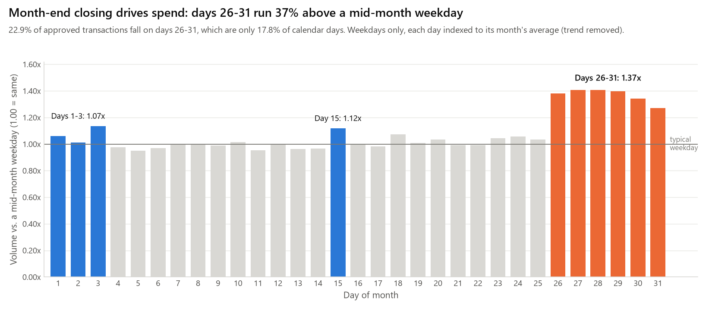

### 7. The typical purchase is $191, not $384

Ticket sizes are log-normal: skew is 9.7, and -0.04 after a log transform. A long right
tail pulls the mean up to 2.0x the median (p90 $879).

- **Why it matters:** a mean-based "average ticket" overstates what most clients spend, and it moves with a handful of
  large invoices.
- **Action:** report the median (and p90) for ticket KPIs. Keep the mean only where totals matter
  (revenue = count x mean).

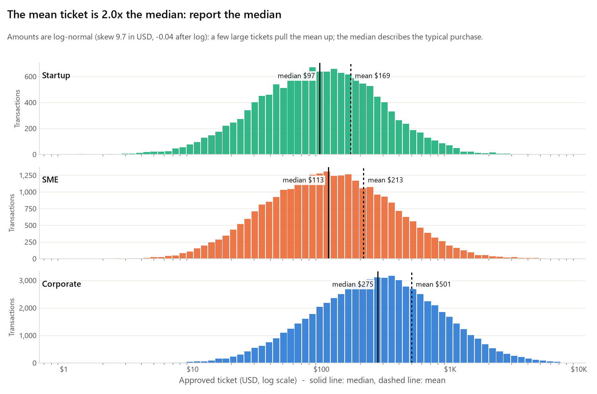

### 8. Robust anomaly rules raise 26x fewer false alarms than the 3-sigma rule

The classic per-card 3-sigma rule was run over 107,020 approved transactions. It raises 2,226
alerts (2.1% of transactions) to find 28 of the 32 injected spending
spikes, a precision of 1.3%. A robust modified z-score (median/MAD on category-adjusted log amounts)
raises 106 alerts with 22% precision and 72% recall. Requiring
2 or more robust alerts on the same card isolates 7 of the
8 compromised cards among 21 flagged cards; the 3-sigma rule flags
648 cards. A velocity rule catches all 5 card-testing cards with
0 false positives.

- **Why:** amounts are skewed, so a value 3 standard deviations above the mean is routine for a legitimate large bill.
  The spikes also inflate the very standard deviation used to detect them (masking).
- **Action:** replace the 3-sigma alert with the robust score plus the burst rule, and queue investigations by card.
  Card-testing bursts should trigger an automatic block, because 16 of 62 test
  charges were approved.

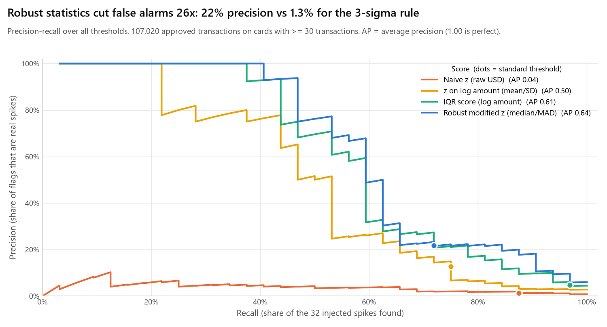

## Methods

**Data and cleaning.** The raw table has 120,267 rows. The view `transacciones_limpias` removes
duplicates, NULL merchants, negative amounts that are not reversals, and future-dated rows, which leaves
118,951 rows (1.09% removed; see `reports/calidad_datos.md`). Reversals are
negative by design and are excluded from spend. Spend uses approved transactions only, the same definition as
`sql/02_metricas_mensuales.sql`. The 32 injected spikes add $279K
(0.66% of total volume), so they do not change the business findings.

**Growth decomposition.** Monthly volume = active clients x spend per active client, so
ln(V_last / V_first) = ln(clients ratio) + ln(spend-per-client ratio). Client growth accounts for
113% of the log growth; a value above 100% means spend per client fell. The ramp
curve uses new clients only. Tenure is measured in months since the first approved transaction, steady state is the
median of months 3 and later, and month 0 is usually a partial month.

**Seasonality.** Only weekdays are used, because the weekend effect is separate. Each day is divided by the average
weekday of its own month, which cancels the growth trend. The ratios are then averaged by day of month and re-based so
that a mid-month weekday (days 4-25, excluding the 15th) = 1.00.

**Segment decomposition.** Spend per active client = cards per client x approved transactions per card x mean ticket.
The mean is the correct statistic for this identity, because totals are count x mean.

**Cohorts and retention (fixed in phase 2).** Phase 1 used *cohort = signup month*. Recomputed here, that definition
gives 77.8% at month 1, 98.2% at month 3 and 86.7% at month 6. Retention that
rises between month 1 and month 3 is a red flag. The first card arrives a median of
19 days after signup, so many clients had not transacted yet in their signup
month (only 37.2% were "active" in month 0). Those early columns measured *activation*, not retention.

The corrected definition:

- cohort = the month of the client's first approved transaction;
- only clients who signed up inside the window are included, because for older clients the true first month cannot
  be observed;
- retention(k) = the share of the cohort with at least one approved transaction in month k;
- a cohort contributes only to months that are observable, and the pooled curve is weighted by eligible clients.

`sql/05_cohortes_retencion.sql` was rewritten with the same definition and returns the same numbers. Points with fewer
than 30 eligible clients are left out of the pooled curve, because late months come from only one
or two small cohorts.

**Why the median beats the mean here.** If ln(amount) ~ N(mu, sigma^2), the median is e^mu but the mean is
e^(mu + sigma^2/2). The mean sits above the typical value by a factor that grows with the spread, and a few large
tickets move it. The median is not affected by the tail.

| Segment | Approved tx | Mean | Median | p90 | p99 | Skew | Skew of log | Mean / median |
|---|---:|---:|---:|---:|---:|---:|---:|---:|
| Startup | 14,191 | $169 | $97 | $371 | $1,059 | 9.5 | -0.10 | 1.74x |
| SME | 28,603 | $213 | $113 | $481 | $1,467 | 7.3 | 0.02 | 1.88x |
| Corporate | 67,879 | $501 | $275 | $1,121 | $3,532 | 8.7 | -0.03 | 1.83x |
| All | 110,673 | $384 | $191 | $879 | $2,948 | 9.7 | -0.04 | 2.01x |

**Anomaly detection.** The ground truth is `data/anomalias_inyectadas.csv`: 32 spike transactions on
8 cards (amounts set to 10-30x the card's mean) and 62 card-testing transactions on
5 cards. Spike detectors score every approved transaction on cards with at least
30 approved transactions (107,020 transactions on 673 cards; all
32 spikes are in scope). Each transaction is scored against its own card's history:

- *Naive z-score*: (amount - card mean) / card SD on raw USD; alert if > 3.
- *z-score on log amount*: the same formula on r = ln(amount) - median ln(amount) of the merchant category. This fixes
  the skew (and a USD 900 meal is no longer compared with a USD 900 software bill), but it still uses mean and SD.
- *Tukey IQR fence*: alert if r > Q3 + 1.5 x IQR of the card.
- *Robust modified z*: 0.6745 x (r - median) / MAD; alert if > 3.5 (Iglewicz and Hoaglin).
- *Card-level cluster rule*: alert on a card with at least 2 robust alerts.
- *Card-testing burst rule*: alert when at least 5 transactions below USD 5 (any status)
  hit the same card within 10 minutes.

All thresholds are the textbook defaults; none were tuned on the ground truth. The precision-recall chart shows every
threshold.

## Anomaly-detection evaluation

**Spending spikes, transaction level** (32 positives among 107,020 transactions)

| Method | Level | Flagged | TP | FP | FN | Precision | Recall | F1 |
|---|---|---:|---:|---:|---:|---:|---:|---:|
| Naive z-score > 3 (raw USD, mean/SD) | transaction | 2,226 | 28 | 2,198 | 4 | 1.3% | 87.5% | 0.025 |
| z-score > 3 on log amount (mean/SD) | transaction | 188 | 24 | 164 | 8 | 12.8% | 75.0% | 0.218 |
| Tukey IQR fence (Q3 + 1.5 IQR, log amount) | transaction | 650 | 31 | 619 | 1 | 4.8% | 96.9% | 0.091 |
| Robust modified z > 3.5 (median/MAD, log amount) | transaction | 106 | 23 | 83 | 9 | 21.7% | 71.9% | 0.333 |

**Card level and card testing**

| Method | Level | Flagged | TP | FP | FN | Precision | Recall | F1 |
|---|---|---:|---:|---:|---:|---:|---:|---:|
| Spikes: card has >= 1 naive 3-sigma flag | card | 648 | 8 | 640 | 0 | 1.2% | 100.0% | 0.024 |
| Spikes: card has >= 2 robust flags | card | 21 | 7 | 14 | 1 | 33.3% | 87.5% | 0.483 |
| Spikes: >= 3 tx at >= 25x card median (sql/06 6.2)* | card | 14 | 8 | 6 | 0 | 57.1% | 100.0% | 0.727 |
| Card testing: >= 5 tx < USD 5 in 10 min | card | 5 | 5 | 0 | 0 | 100.0% | 100.0% | 1.000 |
| Card testing: same burst rule (transactions) | transaction | 62 | 62 | 0 | 0 | 100.0% | 100.0% | 1.000 |

**Reading the tables**

- **The 3-sigma rule produces too many false positives.** On log-normal data a z above 3 is not rare, so
  2,198 legitimate transactions on 648 of 673 cards are flagged.
  An analyst would review 80 alerts for every real spike.
- **The 3-sigma rule also suffers from masking.** The spikes inflate their card's SD by
  1.9-3.2x (median 2.0x), while
  the median moves only 2.3% (median across cards). With the contaminated
  baseline, 3-sigma catches 28 spikes; with a clean baseline the same rule would
  catch 32. Switching to log amounts alone removes most false
  positives (188 alerts, 13% precision), but mean and SD are still contaminated, and over
  all thresholds that score is dominated by the robust one (average precision 0.50 vs
  0.64). The fix has to be robust statistics, not only a transformation.
- **Robust statistics hold the threshold in place.** The median and MAD barely move when outliers are present, so the
  threshold stays where it should. The modified z reaches 22% precision at 72% recall
  (F1 0.33 vs 0.025). The IQR fence trades precision for recall (5% / 97%).
  Average precision over all thresholds is 0.64 for the robust z and
  0.04 for the naive z.
- **Spikes are a card-level pattern.** Two or more robust alerts on the same card is a strong signal
  (33% precision, 88% of compromised cards found). The card is also the
  natural unit for an investigation queue.
- **(\*) Phase-1 SQL rule.** This rule (at least 3 transactions at 25x or more the card's median)
  flags 14 cards and finds 8 of 8. It is also
  median-based, which is why it works, but its thresholds were set while building the dataset with knowledge of the
  injected 10-30x multipliers, so read it as an optimistic upper bound rather than a fair benchmark.
- **Card testing needs a velocity rule, not an amount rule.** The charges are tiny, so amount-based scores never see
  them. The burst rule finds 62 of 62 test transactions with
  0 false positives.
- **Limits.** A single amount score per transaction cannot be both precise and complete here. Amounts within a card
  legitimately vary by more than an order of magnitude, so some spikes look like a large normal invoice. Production
  systems add context such as merchant novelty, time of day, velocity and device.

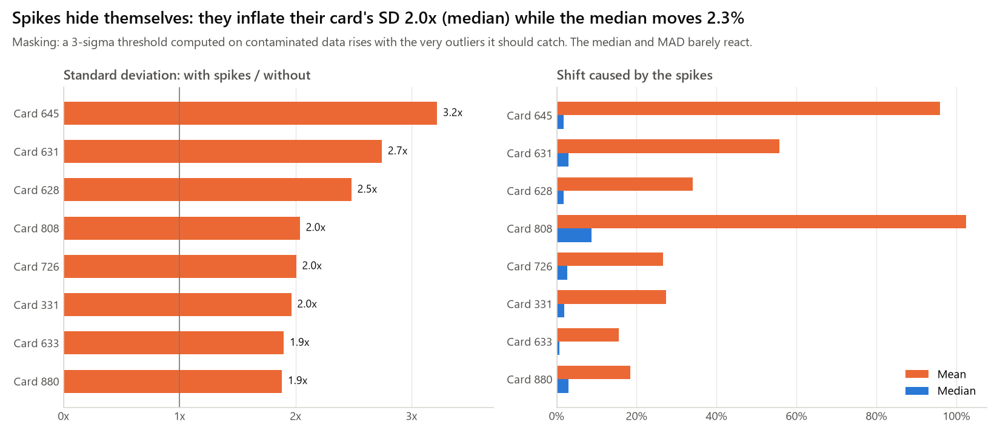

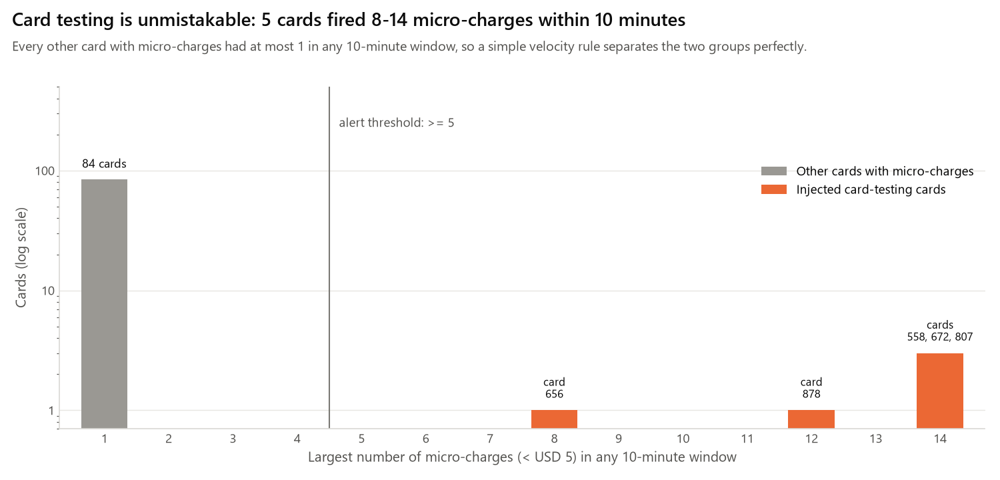
